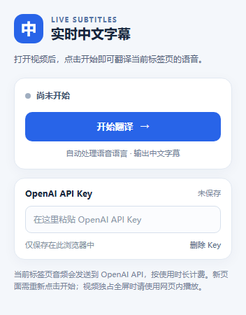
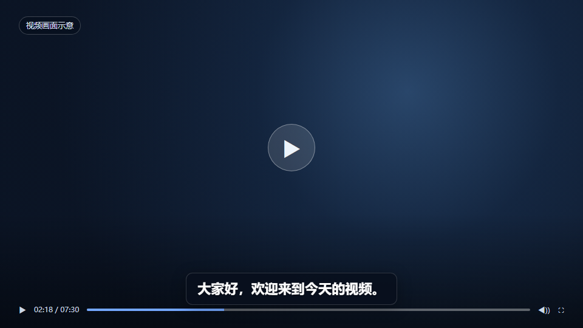

# 视频实时中文字幕（Chrome 扩展）

扩展采集当前 Chrome 标签页的声音，持续发送给 OpenAI 的 `gpt-realtime-translate`，把返回的简体中文字幕显示在网页底部。只设置目标语言为中文，不预先指定输入语言。原声仍可通过耳机播放。无需 Python 或本机模型。

## 界面预览

扩展弹窗（未启动状态）：

字幕覆盖效果（模拟视频画面与示例字幕，未调用翻译 API）：

## 使用方法

1. 在 [OpenAI 平台](https://platform.openai.com/api-keys)创建一个 API Key，并确保 API 账户可用。API 使用会单独计费。
2. 在 Chrome 地址栏打开 `chrome://extensions`，开启右上角“开发者模式”。
3. 点击“加载已解压的扩展程序”，选择这个 `realtime-extension` 文件夹。
4. 打开普通网站的视频页面并播放，点击扩展图标，粘贴 API Key，点击“开始翻译”。以后使用不必重复填写。
5. 看完点击“停止翻译”，或关闭视频标签页。打开新页面后需重新点击“开始翻译”。要移除 Key，点击“删除 Key”。

如果之前已加载旧目录，请在 `chrome://extensions` 中移除旧扩展，再从 `realtime-extension` 文件夹重新加载。API Key 可能需要重新填写。

Key 保存在此 Chrome 扩展的本地存储中，不写入源代码，也不会交给视频网站。扩展会持续发送当前标签页的声音到 OpenAI API，并用临时会话凭证建立实时连接。请只在自己信任的 Chrome 用户配置中安装此扩展，不要把带有密钥的浏览器配置分享给别人。DeepSeek Key 不能用于此接口。

## 目前的限制

- 字幕会逐步出现，但仍有网络与翻译处理延迟，无法保证与视频声音完全同步。
- 适用于允许扩展注入脚本的普通 HTTP/HTTPS 网页。Chrome 内部页面、扩展页及部分特殊网站无法显示字幕。
- 输入语言由实时翻译模型从声音中处理；目前不显示识别到的语言名称。混合语言、中文原声及具体网站兼容性需要实际试听验证。
- 页面重新加载或导航到新页面时翻译会停止，需要再次点击“开始翻译”。
- 若播放器使用视频元素独占全屏，网页字幕可能被遮住；可退出全屏改用网页内播放。受保护媒体也可能无法采集。
- 语音识别与翻译可能出错；API 服务也可能拒绝某些片段。

## 技术来源

- [Chrome Tab Capture](https://developer.chrome.com/docs/extensions/reference/api/tabCapture)
- [Chrome Offscreen API](https://developer.chrome.com/docs/extensions/reference/api/offscreen)
- [OpenAI 实时翻译](https://developers.openai.com/api/docs/guides/realtime-translation)
- [GPT-Realtime-Translate 模型](https://developers.openai.com/api/docs/models/gpt-realtime-translate)
